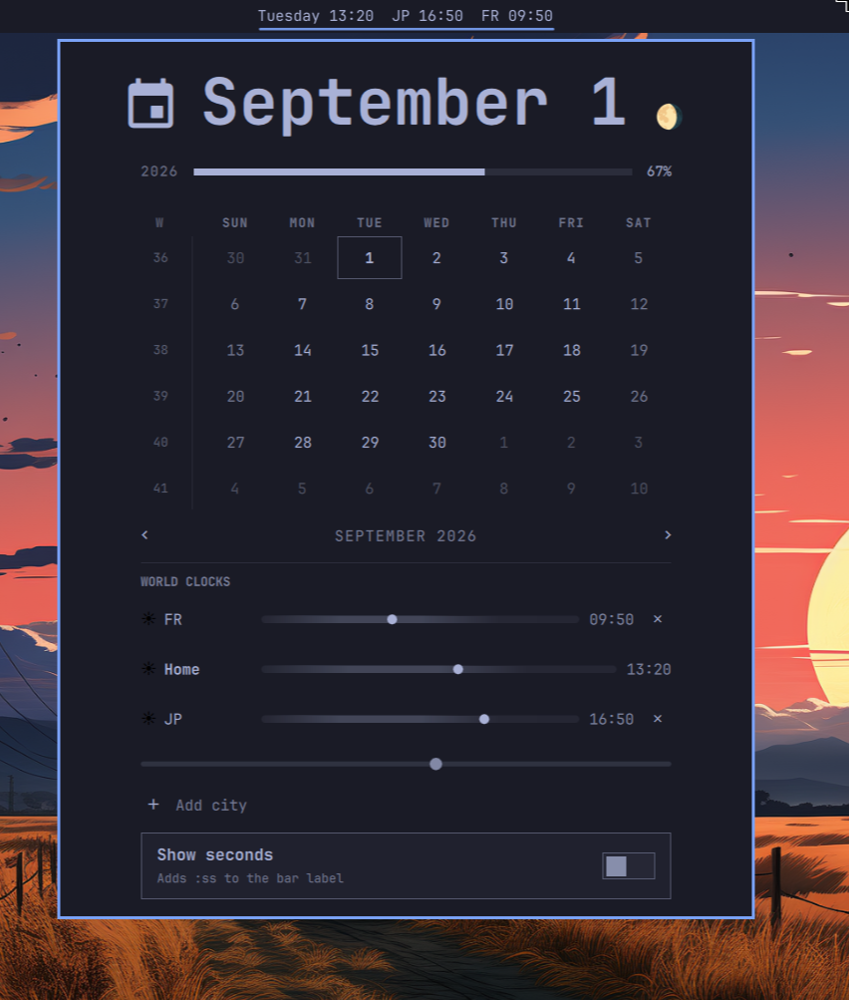

<div align="center">

# Better Clock for Omarchy

**An enhanced clock bar widget for [Omarchy](https://omarchy.org/) — everything the built-in clock does, plus seconds, sorted world clocks with a magnetic scrubber, and a moon phase.**

[](LICENSE)
[](manifest.json)
[](https://omarchy.org/)

*Part of [OMARCHY100](https://github.com/AROICE-HQ/omarchy100) — a 100-plugin suite for Omarchy.*

[Features](#features) • [Install](#install) • [Usage](#usage) • [How it works](#how-it-works)

</div>

Omarchy's built-in clock is already good: a bar pill with cyclable formats,
a calendar popup with ISO week numbers, year progress, and a hidden
memento-mori life bar. This plugin starts from that exact code (cloned, not
rebuilt) and adds a seconds display, a proper world-clock row with a
day/night rail and a drag-to-preview scrubber, and a small moon phase badge
— everything the built-in clock leaves out.

It installs as its own independent plugin — both it and the built-in clock
can be enabled at once, so you can compare them side by side before
deciding which stays on your bar.



## Contents

- [Features](#features)
- [Install](#install)
- [Usage](#usage)
- [How it works](#how-it-works)
- [External dependencies](#external-dependencies)
- [Settings storage](#settings-storage)
- [Uninstalling](#uninstalling)
- [Changelog](#changelog)
- [License](#license)
- [Author](#author)

## Features

Everything the built-in `omarchy.clock` already has:

- Bar pill with a cyclable label format (right click walks presets: `dddd
  HH:mm`, 12-hour, `HH:mm`, `ddd d MMM`, ISO `yyyy-MM-dd`, and their
  vertical-bar equivalents).
- Middle click opens the system timezone picker.
- Calendar popup: a fixed six-row month grid, ISO week numbers down the
  left gutter (click **W** to switch Monday/Sunday start), keyboard and
  scroll-wheel month navigation, and a year-progress rail.
- Double-tap the year rail to set a birth year and a life-expectancy —
  it's the same easter egg, unchanged.

New in this plugin:

- **Show seconds** — a toggle below the world clocks. Appends `:ss` to the
  bar label and switches the clock to second-precision ticking only while
  it's on.
- **World clocks** — add any number of cities by searching a real list of
  IANA timezones (the same one `timedatectl list-timezones` prints), with
  an optional custom label. Rows show that zone's live time and flag when
  it's already tomorrow or still yesterday there. Configured clocks also
  show as short country-code segments right in the bar pill (e.g. `IN
  21:47`).
- **Home row** — your system's own timezone, pinned first and always
  visible, so every other zone has a fixed point of reference.
- **Sorted west-to-east** — all rows (home included) sort by UTC offset,
  not by the order you added them.
- **Day/night at a glance** — a ☀/☾ glyph and a compact 24-hour rail per
  row, with a marker at that zone's current position in its day.
- **Magnetic scrubber** — drag the handle below the rows and every zone
  previews what time it'd be there at that same instant, snapped to
  15-minute marks. Release to go back to live time. Built for figuring out
  a meeting time across zones without doing the math yourself.
- **Moon phase** — a small badge next to the hero date (hover for the
  phase name), computed locally with no network call.

## Install

```
omarchy plugin add https://github.com/AROICE-HQ/omarchy-clock.git --enable
```

Or, to develop/inspect it locally first:

```
omarchy plugin clone io.github.aryan-techie.clock --edit
```

(swap in this repo's contents, or copy this folder to
`~/.config/omarchy/plugins/io.github.aryan-techie.clock/` directly and run
`omarchy-shell shell rescanPlugins` if it doesn't pick up right away).

## Usage

| Action | Effect |
|---|---|
| Left click | Open the calendar popup |
| Right click | Cycle the bar label format |
| Middle click | Open the system timezone picker |
| `[` / `]` (popup open) | Previous / next month |
| `{` / `}` (popup open) | Previous / next year |
| `t` (popup open) | Jump back to today |
| `w` (popup open) | Toggle Monday/Sunday week start |
| Double-tap year rail | Set/clear birth year + life expectancy |

### Adding a world clock

Open the popup, scroll to **World Clocks**, click **Add city**, and search
for a city or timezone by name (e.g. `tokyo`, `london`, `Asia/Kolkata`).
Pick one from the results, optionally give it a label, and confirm. An
unrecognized entry can't be selected in the first place — the list only
offers real IANA zones.

### Using the scrubber

Once you've added at least one city, a small handle appears below the
rows. Drag it left or right — every row updates together to show what
time it'd be there at that hour, snapped to 15-minute marks. Let go and
they all snap back to showing the real current time.

## How it works

- **Seconds toggle**: `Model.withSeconds()` inserts `:ss` right after the
  first `mm` token in whichever format is currently active. `SystemClock`
  only switches to second precision while the toggle is on, matching the
  built-in widget's minute precision otherwise.
- **World clock times**: this shell's JS engine accepts
  `Intl.DateTimeFormat`'s `timeZone` option syntactically but does not
  actually resolve real zone names with it, so this plugin doesn't use
  Intl for time math at all. Instead, one batched `date`/`TZ` subprocess
  per minute covers every configured zone (plus the detected home zone) at
  once — the same mechanism `timedatectl`/the system's own timezone picker
  already rely on, so the underlying tzdata is known-good.
- **Home zone**: detected once via `timedatectl show --property=Timezone
  --value`, the same source the system's timezone picker uses.
- **Sorting**: each row's numeric UTC offset (`date`'s `%z`) drives a
  west-to-east sort; a row with a bad/unresolvable offset sorts last
  instead of breaking the comparison.
- **Short bar-pill labels**: a custom label always wins; otherwise the
  zone's ISO country code is looked up from tzdata's own
  `zone1970.tab` (e.g. `Asia/Kolkata` → `IN`), falling back to a
  cleaned-up zone-name tail if that lookup ever misses.
- **Scrubber**: purely arithmetic once the current UTC offsets are known —
  dragging never triggers another subprocess call. Each row's hypothetical
  time is just the scrub position plus that row's offset difference from
  home's.
- **Moon phase**: a Julian-day synodic-month approximation (accurate to
  roughly a day), computed inline — no API, no network.
- **Settings** live in the same place the built-in clock's do: inline in
  the widget's own entry in `~/.config/omarchy/shell.json`, written back
  through the shell's `updateEntryInline` call — no separate state file.

## External dependencies

This plugin runs `bash`, `date`, `cat`, and `timedatectl` via Quickshell's
`Process` — all standard on any Omarchy install, no extra packages
required. Nothing it runs touches the network or needs elevated
privileges; zone names are always passed as real argv entries, never
interpolated into a shell string.

## Settings storage

Nothing this plugin adds writes anywhere outside
`~/.config/omarchy/shell.json` (the same file every bar widget's layout
and settings already live in). No network calls, no other state files.

## Uninstalling

```
omarchy plugin remove io.github.aryan-techie.clock
```

This removes the plugin and its bar entry. The built-in clock (if you
still have it enabled) is unaffected.

## Changelog

See [CHANGELOG.md](CHANGELOG.md).

## License

MIT — see [LICENSE](LICENSE).

## Author

**Aryan Techie** ([Aryan Jangra](https://aryan.aroice.in))

- 🌐 Website: [aryan.aroice.in](https://aryan.aroice.in)
- 📧 Email: [aryan@aroice.in](mailto:aryan@aroice.in)
- 🐙 GitHub: [@Aryan-Techie](https://github.com/Aryan-Techie)
- 🏢 Organization: [AROICE](https://aroice.in)

---

<div align="center">

**Made with ❤️ by [AROICE](https://github.com/AROICE-HQ)**

*Clear tools for a clear mind.*

</div>
